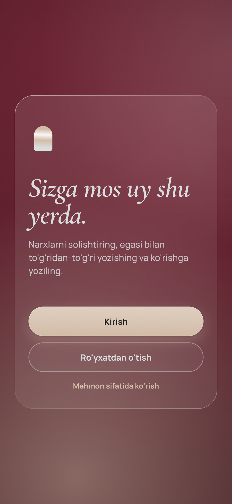
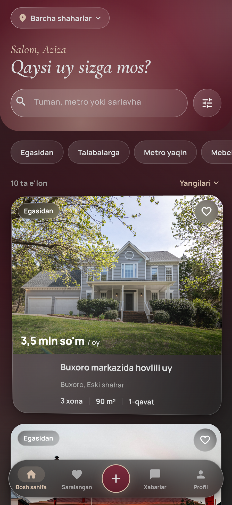
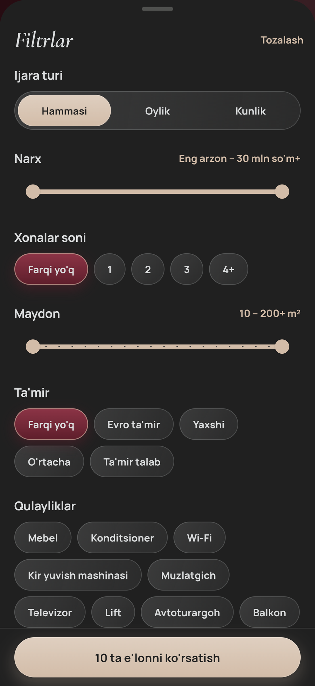
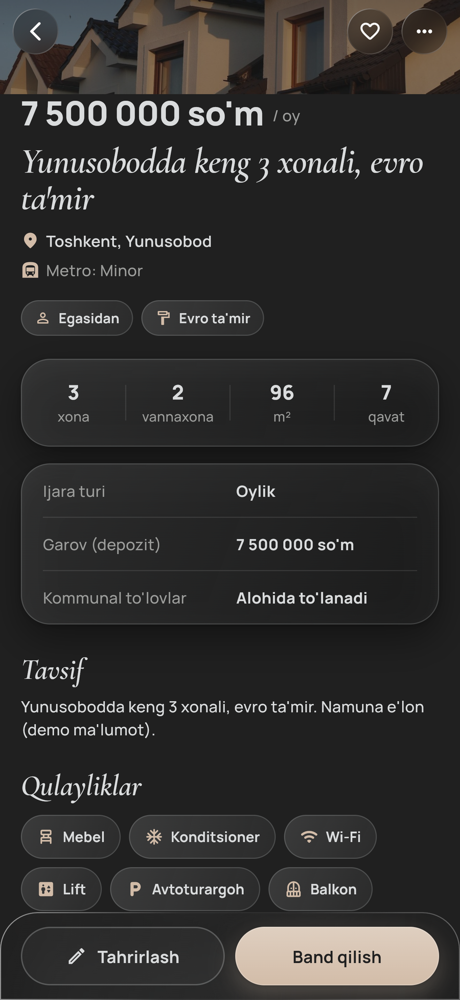
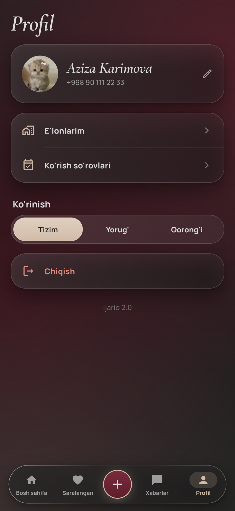
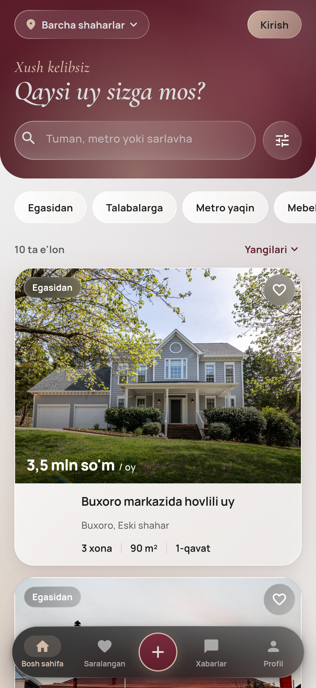
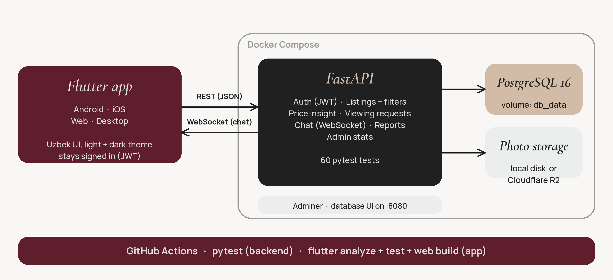
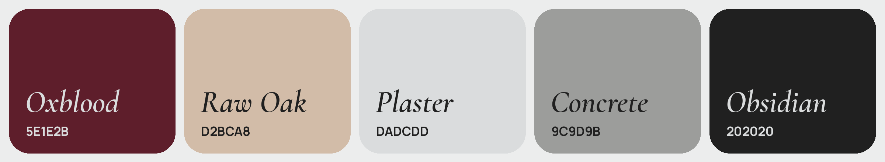

<p align="center">
  
</p>

<h1 align="center">Ijario</h1>

<p align="center">
  <b>Rental marketplace for Uzbekistan</b><br>
  Flutter app (Android · iOS · web) · FastAPI + PostgreSQL API · Docker<br>
  <sub>Product language: Uzbek · <i>Sizga mos uy shu yerda.</i></sub>
</p>

<p align="center">
  
  
  
  
  <a href="https://github.com/javohir-io/ijario/actions/workflows/backend.yml"></a>
  <a href="https://github.com/javohir-io/ijario/actions/workflows/app.yml"></a>
  
</p>

> Ijario grew out of my earlier two-repo project, OsonIjara ([app](https://github.com/javohir-io/oson-ijara-app) · [backend](https://github.com/javohir-io/oson_ijara_backend)), rebuilt as a single repository with a new design system, an Uzbek UI, price insight, viewing requests and a redesigned API.

## Overview

Renters browse listings without an account, compare prices, message owners and book a viewing. Owners post listings with photos, confirm or decline viewing requests, and mark a flat as rented when it is gone.

## Features

**Finding a place**
- Browse as a guest; sign in only to save, chat, book or post
- Filters: city and district (Tashkent's 12 tumans), price, rooms, area, renovation, amenities, owner-only (no agent), near metro, utilities included, student-friendly
- Prices in **so'm or USD**, monthly or daily; sorting and filtering compare them correctly
- **Price insight:** how a listing compares with similar ones in its district (only shown when there is enough data, never guessed)

**Getting in touch**
- **Viewing requests:** pick a day and hour, the owner confirms or declines, both sides get a chat message
- Real-time chat (WebSocket) with auto-reconnect, quick replies and the listing pinned at the top
- One-tap call and Telegram buttons (contact details are only shown to signed-in users)

**For owners**
- 4-step listing wizard with photo upload
- Mark as rented (leaves search, stays in "E'lonlarim"), views and saves per listing
- Report a listing; admin stats

**Polish**
- Light, dark and system theme · custom design system · fonts bundled for offline use
- Skeleton, empty and error states · reduced-motion support · stays signed in

## Screenshots

### Mobile app

| Welcome | Home | Filters |
|:--:|:--:|:--:|
|  |  |  |

| Listing + price insight | Book a viewing | Dark theme |
|:--:|:--:|:--:|
|  |  |  |

## Architecture



| Part | Folder | Stack |
|---|---|---|
| Mobile / web app | [`ijario-app/`](ijario-app) | Flutter, Dart, `ChangeNotifier` stores, CustomPainter |
| API | [`ijario-backend/`](ijario-backend) | FastAPI, SQLAlchemy, PostgreSQL 16, JWT, WebSockets, Docker |
| Docs | [`docs/`](docs) | [`DESIGN.md`](docs/DESIGN.md), [`CHANGELOG.md`](docs/CHANGELOG.md), Postman collection in `ijario-backend/postman` |

**Notable decisions**
- **Honest price insight.** Compares a monthly price with active listings of the same city, currency and room count (same district first). With too few comparable listings it returns nothing instead of a made-up number.
- **Mixed currencies.** Filters and sorting convert USD to so'm with a configurable rate; a daily rate sorts as about 30 days, so "cheapest first" is not fooled by a smaller number.
- **Privacy by design.** Owner phone and Telegram are only sent to signed-in users, so listings cannot be scraped for phone numbers.
- **Safe upgrades.** `app/migrate.py` adds new columns to an existing database on startup; tested by upgrading a genuine 1.0 PostgreSQL database.
- **One source of design truth.** Palette, radii, motion and shadows live in one tokens file; every screen reads from it.
- **Security basics:** bcrypt, JWT, validated input (phone, enums), upload extension allow-list.

## Design

Palette: **Oxblood** `#5E1E2B`, **Raw Oak** `#D2BCA8`, **Plaster** `#DADCDD`, **Concrete** `#9C9D9B`, **Obsidian** `#202020`. Fonts: Cormorant Garamond Italic for display, Manrope for the interface (Latin-Extended and Cyrillic, so Uzbek and Russian both render). Details in [`docs/DESIGN.md`](docs/DESIGN.md).



## Getting started

**Requirements:** Docker Desktop, Flutter SDK.

```bash
# 1. API + PostgreSQL + Adminer
cd ijario-backend
docker compose up -d --build            # API: http://localhost:8000/docs
docker compose exec api python -m app.seed    # optional demo data with photos

# 2. App (new terminal)
cd ijario-app
flutter pub get
flutter run -d chrome
# Android emulator:
flutter run --dart-define=API_BASE_URL=http://10.0.2.2:8000
```

For `API_BASE_URL` use `http://10.0.2.2:8000` on the Android emulator, `http://localhost:8000` in Chrome or the iOS simulator, and your computer's LAN IP on a real phone.
A `.env` file is optional; copy `ijario-backend/backend/.env.example` to change settings (set a real `SECRET_KEY` before deploying anywhere public).

**Demo accounts (development only)**

| Role | Email | Password |
|---|---|---|
| Owner | `demo.owner@ijario.uz` | `demo12345` |
| Agent | `demo.agent@ijario.uz` | `demo12345` |
| Renter | `demo.renter@ijario.uz` | `demo12345` |

Remove the demo data any time with `docker compose exec api python -m app.seed --remove`. Demo listings use free [Pexels](https://www.pexels.com) photos ([credits](ijario-backend/backend/app/seed_assets/CREDITS.md)) and fictional people.

## Tests

```bash
cd ijario-backend/backend && pip install -r requirements-dev.txt && pytest -q   # 60 tests
cd ijario-app && flutter analyze && flutter test
```

Both run in GitHub Actions on every push.

## Status

| Part | State |
|---|---|
| `ijario-backend/` | 60 automated tests; exercised against PostgreSQL 16, including an upgrade from the OsonIjara database |
| `ijario-app/` | Runs in Chrome against the API <!-- UPDATE this line after you click through every flow: posting, viewing request, chat --> |
| Automated UI tests | None yet |
| Deployment | Not deployed; no email or push notifications yet |

**Known limitations:** no password reset or email verification; the feed loads up to 200 listings at once (needs real pagination at scale); photos use local disk unless Cloudflare R2 is configured; CORS is open (`*`) and the chat token travels in the WebSocket URL, so tighten both for production; Android and iOS builds have not been tested on physical devices.

**Roadmap:** deploy (hosted PostgreSQL + static web build), password reset, pagination, map view, push notifications.

## License

[MIT](LICENSE) © 2026 Javohir Abduvahhobov. Bundled fonts are under the SIL Open Font License.
